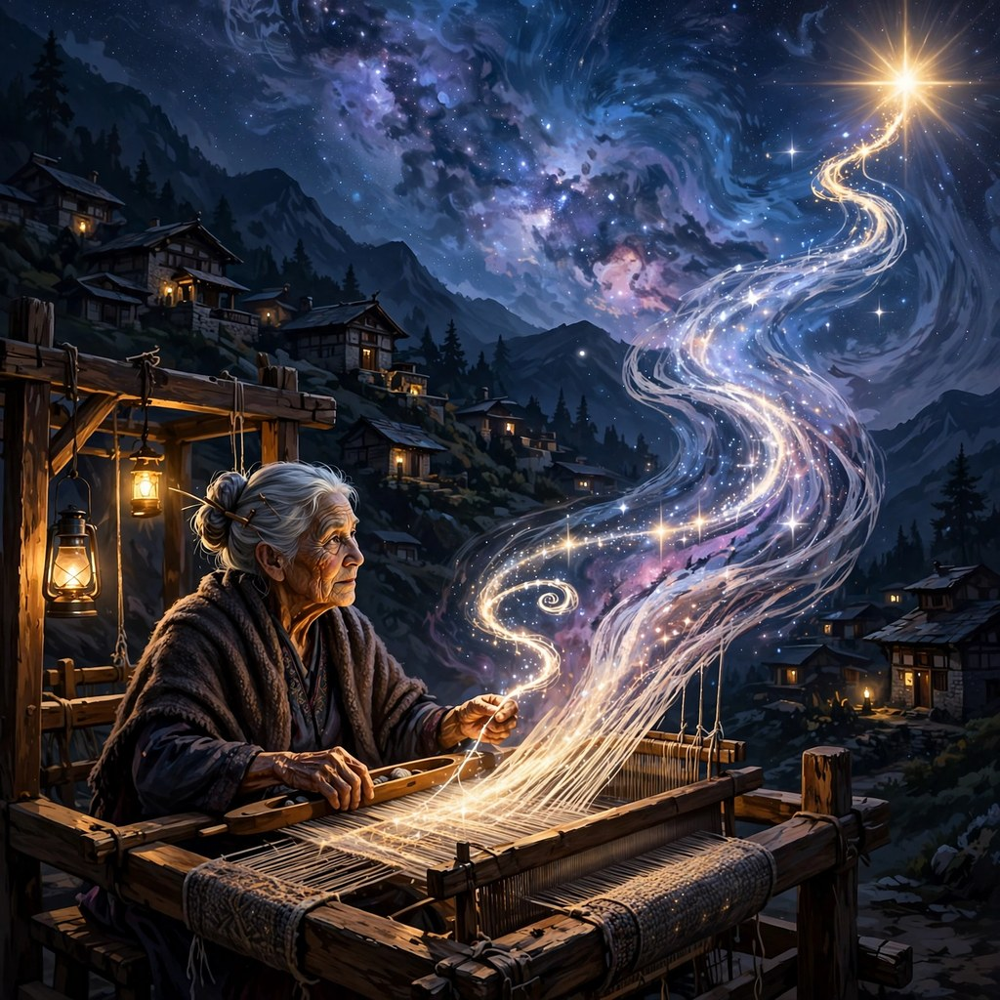

[](https://make.fun/bounty/ai-excited-01)
[](https://make.fun/bounty/ai-excited-01)
[](https://make.fun/bounty/ai-excited-01)

# The Weaver of the Night Sky

A silver-haired grandmother sits at a wooden loom in a mountain village at night, weaving threads of starlight. The glowing threads rise out of the loom and flow upward into the Milky Way, and one single spiral thread reaches out toward the brightest star in the sky. A quiet, impossible moment: one woman weaving the night itself, thread by thread.



## Run

```bash
mkdir -p out && MAKEFUN_OUTPUT_DIR=out node main.ts
```

This copies `entry.png` to `out/entry.png` and verifies the copy with a SHA-256 hash.

## Referral

Built for make.fun's [Make the AI judge excited](https://make.fun/bounty/ai-excited-01) bounty — join with my link: https://make.fun/r/qk9k9vgs
